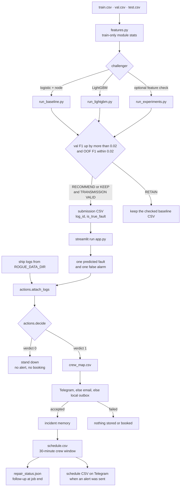

# Rogue Protocol

Two stages. The Kaggle scripts score ship logs and write a verdict CSV. The response desk reads that CSV, joins it to the ship logs, and acts only on predicted faults.

## Kaggle scoring

Cursor does not train these models. Upload this folder into a Kaggle notebook and run it there, with `train.csv`, `val.csv`, and `test.csv` attached.

In the notebook, run `pip install -r requirements.txt` first. That installs pandas, numpy, scikit-learn, LightGBM, and Streamlit. If LightGBM still fails to import, `run_lightgbm.py` skips it and leaves the logistic file in place.

### Order

1. Upload a valid starter CSV and leave it in place.
2. `pip install -r requirements.txt`
3. `python run_baseline.py --data-dir /kaggle/input/<your-dataset>` writes `outputs/submission_node.csv`. It does not overwrite `outputs/submission_baseline.csv`.
4. Upload `outputs/submission_node.csv` only if the script prints `RECOMMEND` and `TRANSMISSION VALID`. If it prints `RETAIN`, upload the old baseline file.
5. `python run_lightgbm.py --data-dir /kaggle/input/<your-dataset>`
6. Upload `outputs/submission_lightgbm.csv` only when the script prints `KEEP` and `TRANSMISSION VALID`. Otherwise keep the baseline file.
7. Optional feature check, still logistic regression: `python run_experiments.py --data-dir /kaggle/input/<your-dataset>`
8. Optional, only with time left: add `--hgb` to that command. There is no blend.

A challenger is kept only when validation F1 rises by more than 0.02 and its train-only out-of-fold F1 is within 0.02 of that validation F1. Each model tunes its own hard threshold. Compare F1, precision, recall, and the predicted-positive count.

Re-running a script does not overwrite a file that already passed the format check. Delete that CSV and its metrics JSON if you intend to regenerate it.

## Response desk

`streamlit run app.py` opens NINE // AUTONOMOUS RESPONSE DESK. Copy `.env.example` to `.env` and set `TELEGRAM_BOT_TOKEN` and `TELEGRAM_CHAT_ID`. The token stays out of git.

Point `ROGUE_DATA_DIR` at the folder that holds `train.csv`, `val.csv`, and `test.csv`. Upload a verdict CSV in the page. One press samples the first predicted fault and one false alarm, then runs the sequence. A live Telegram run sends at most four alerts.

| Verdict | Actions |
|---|---|
| `1` | notify the module crew, store the incident, book a 30-minute repair, queue follow-up at the job end |
| `0` | stand down |
| anything else | skip the row |

A failed alert does not store or book that fault. A `log_id` already in the schedule or the accepted outbox is skipped. `crew_map.csv` maps each module to a crew. Replace the `REPLACE_` ids and contacts before a live roster is used.

Incident search uses ChromaDB when it is installed, then FAISS, then scikit-learn TF-IDF. This repo does not install those extra libraries.

## Files

| File | Needs | Writes |
|---|---|---|
| `requirements.txt` | nothing | the pip install list |
| `config.py` | nothing | nothing |
| `data_io.py` | the three CSVs | three dataframes in memory |
| `features.py` | a dataframe and train-only module stats | model columns |
| `modeling.py` | feature columns and train labels | logistic, LightGBM, or tree probabilities |
| `threshold.py` | labels and probabilities | a hard threshold and F1, precision, recall, positive count |
| `submission.py` | test ids in file order and probabilities | `log_id,is_true_fault` |
| `run_baseline.py` | the three CSVs and, for the comparison, the checked baseline metrics | `outputs/submission_node.csv`, `outputs/metrics_node.json` |
| `run_lightgbm.py` | the three CSVs and a checked baseline | `outputs/submission_lightgbm.csv`, `outputs/metrics_lightgbm.json` |
| `run_experiments.py` | the three CSVs | `outputs/metrics_experiments.json`, and `outputs/submission_candidate.csv` only if the feature change earns the gain |
| `actions.py` | a verdict row | action names only |
| `agent.py` | decided actions, `crew_map.csv` | outbox, schedule, repair status |
| `memory.py` | an incident record | `outputs/incidents.json` |
| `telegram_bot.py` | `TELEGRAM_BOT_TOKEN` | a Telegram message, and the schedule file after a sent alert |
| `app.py` | ship logs and an uploaded verdict CSV | the response desk |
| `crew_map.csv` | nothing | module, crew, role, contact |
| `.env.example` | nothing | the variable names to copy into `.env` |

`run_baseline.py` with `INCLUDE_NODE` does not write `outputs/submission_baseline.csv`. Do not rerun `run_lightgbm.py` for this check. That script reads the same column list and would also see `node`.
